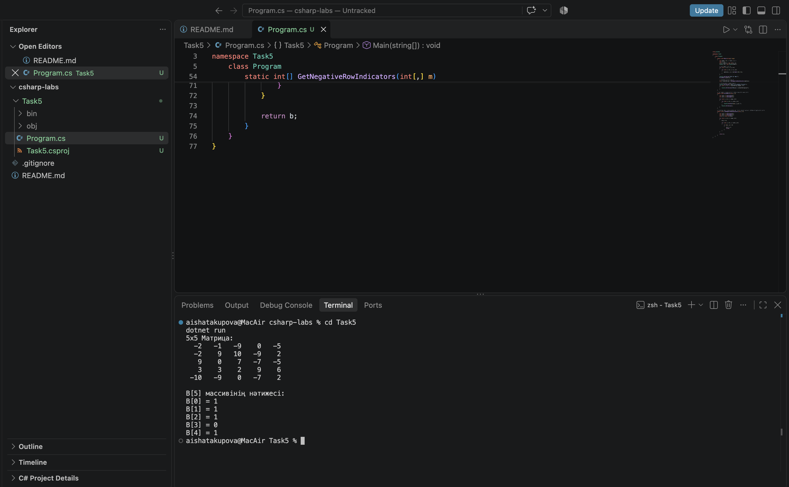

# 5-тапсырма: Екі өлшемді массивтер (2-нұсқа)

| Тест | Кіріс | Қолмен есептеген жауап | Бағдарлама жауабы |
|---|---|---|---|
| Жеке тест | `Random(9)` | `B = [1, 1, 1, 0, 1]` | `B = [1, 1, 1, 0, 1]` |
| Өз тестім 1 | Барлық элементтері оң 5x5 матрица | `B = [0, 0, 0, 0, 0]` | `B = [0, 0, 0, 0, 0]` |
| Өз тестім 2 | Барлық жолында теріс сан бар 5x5 матрица | `B = [1, 1, 1, 1, 1]` | `B = [1, 1, 1, 1, 1]` |

## Сұрақтарға жауап
1. `matrix[i, j]` жазбасындағы `i` матрица жол индексін, ал `j` баған индексін білдіреді. `matrix.GetLength(0)` жолдар санын, ал `matrix.GetLength(1)` бағандар санын қайтарады.
2. Жолда кемінде бір теріс элемент табылғаннан кейін ішкі циклді жалғастырудың қажеті жоқ. `break` операторы ішкі циклді бірден тоқтатып, қалған элементтерді босқа тексермеуге мүмкіндік береді.
3. Матрицаны толтыру кезінде ішкі цикл дәл 25 рет орындалады. Ал `GetNegativeRowIndicators` методындағы ішкі цикл `break` операторының арқасында әр жолда алғашқы теріс сан кездескен бойда тоқтайтындықтан, 25 реттен аз орындалады.

## ЖИ қолдану
Тапсырманы орындау барысында ЖИ-ден 2-нұсқа шарты бойынша екі өлшемді массивті жеке методта өңдеу алгоритмі сұралды. Нәтижесінде `Random(9)` параметрі беріліп, `break` операторы арқылы оңтайландырылған код жазылды және тест кестесі толтырылды.