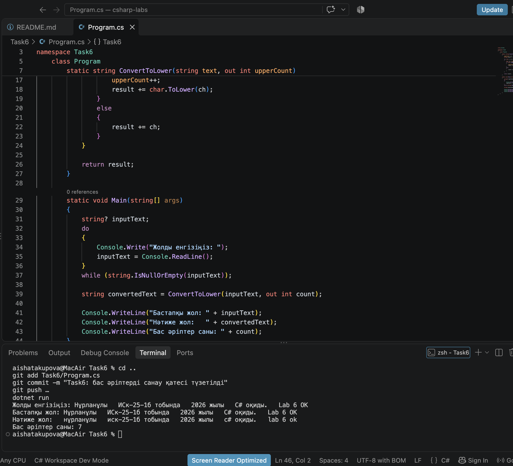

# 6-тапсырма: Символдар тіркесі (4-нұсқа)



| Тест | Кіріс | Қолмен есептеген жауап | Бағдарлама жауабы |
|---|---|---|---|
| Жеке тест | `   Нұрланұлы   ИСк-25-16 тобында   2026 жылы   С# оқиды.   Lab 6 OK   ` | Бас әріптер саны: 7; жол: `   нұрланұлы   иск-25-16 тобында   2026 жылы   с# оқиды.   lab 6 ok   ` | Бас әріптер саны: 7; жол: `   нұрланұлы   иск-25-16 тобында   2026 жылы   с# оқиды.   lab 6 ok   ` |
| Өз тестім 1 | `Әліппе Ң Үй` | Бас әріптер саны: 3; жол: `әліппе ң үй` | Бас әріптер саны: 3; жол: `әліппе ң үй` |
| Өз тестім 2 | `c# 2026!` | Бас әріптер саны: 0; жол: `c# 2026!` | Бас әріптер саны: 0; жол: `c# 2026!` |

## Сұрақтарға жауап

1) `text[i]` жолдың `i`-інші индексінде тұрған бір символды қайтарады, оның типі — `char`. C#-та `string` типін құрғаннан кейін ішіндегі әріптерін тікелей өзгертуге болмайды. Сондықтан `text[i] = 'a';` деп жазсақ, компилятор қате береді.

2) Иә, қазақ әріптері (`Ә`, `Ң`, `Ү`) дұрыс өңделді. Бағдарламаны іске қосып `Әліппе Ң Үй` деп тексеріп көрдім: `char.IsUpper` оларды бас әріп деп танып, санын `3` деп дұрыс есептеді, ал `char.ToLower` кіші әріпке ауыстырып `әліппе ң үй` деп шығарды.

3) `result += ch;` орындалған сайын ескі жол өзгермейді, оның орнына жадта жаңа жол жасалады. Себебі C#-та `string` өзгермейтін болғандықтан, әр символ қосылған сайын ескі жол мен жаңа әріп бірігіп, қайтадан жаңа жол құрылады.

## Кездескен қате
Қате: Бағдарламаны алғаш іске қосқанда бас әріптер кіші әріпке ауысты, бірақ экранға `Бас әріптер саны: 0` деп қате шықты, сондай-ақ `Console.ReadLine()` тұсында сары `warning CS8600` ескертуі пайда болды.
Қалай түзеттім: `ConvertToLower` методындағы `if (char.IsUpper(ch))` ішіне `upperCount++;` жолын қосуды ұмытып кеткен екенмін, соны жаздым. Ал сары ескертуді кетіру үшін `string inputText;` дегенді `string? inputText;` деп өзгерттім.
Түзеткен коммит: d5dc24a

## Git
`git log --oneline --graph --all` командасының нәтижесі:
```text
* d5dc24a (HEAD -> task6, origin/task6) Task6: бас әріптерді санау қатесі түзетілді
* 22ac2ab Task6: бас әріптерді кіші әріпке ауыстыру методы қосылды
* e4ff587 Task6: жоба құрылды және жолды енгізу қосылды
* 62448f4 (origin/main, origin/HEAD, main) chore: .gitignore қосылды және түбірдегі README түзетілді
*   af4bec5 Merge pull request #1 from AbdullaN1/task5
|\  
| * c602920 (origin/task5, task5) Task5: есеп (README.md) толтырылды және толық аяқталды
|/  
* 517fda8 Бастапқы құрылым: .gitignore және түбірдегі README.md
```

1. `task6` тармағында жасалған коммиттер `git merge` командасы арқылы `main` тармағына біріктірілді. Біріктіруден кейін `task6` тармағы өшірілмей, өз коммиттер тарихымен репозиторийдің тармақтар тізімінде сақталып қалды.

2. `commit` жасағанда өзгерістер тек өз компьютеріміздегі жергілікті Git репозиториіне сақталады, ал `push` сол коммиттерді GitHub серверіне жібереді. Егер `push` жасамасақ, мұғалім GitHub-тан соңғы жасалған жұмысты көре алмайды.

3. `.gitignore` файлына `dotnet new gitignore` командасы арқылы .NET жобаларының уақытша және компиляция файлдарын елемеу ережелерін жаздым. `bin/` және `obj/` қалталары кодты іске қосқан сайын автоматты түрде жасалатындықтан, репозиторийде артық файлдар жиналмауы үшін олар қосылмайды.

## ЖИ қолдану
ЖИ-ден 4-нұсқа бойынша дайын `ToLower()` және `Split()` әдістерін қолданбай, цикл мен `char.IsUpper()`, `char.ToLower()` арқылы бас әріптерді санау жолын сұрадым. Берілген мысалға қарап, `ConvertToLower` методын `out` параметрі арқылы бас әріптер санын қайтаратындай етіп өзгерттім және қазақ әріптерімен тексеріп шықтым.